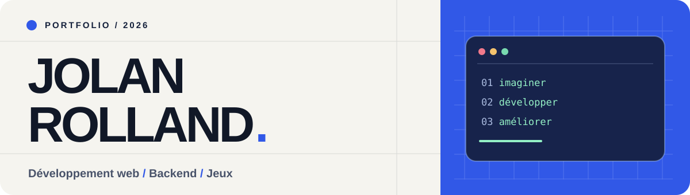

  

  
  

## Salut, moi c'est Jolan 👋

Je suis étudiant en **BUT Informatique à l'IUT d'Orléans**. J'aime construire des applications complètes : penser l'interface, développer la logique métier, concevoir l'API et relier le tout à une base de données. Le web, le backend et les projets interactifs sont les domaines dans lesquels je veux progresser.

> **Je recherche un stage de 16 semaines à partir du 15 février 2027** en développement web ou backend.

### En quelques lignes

- 📍 Basé dans la région d'Orléans.
- 🧩 J'aime résoudre des problèmes concrets et faire évoluer un projet de l'idée à une application utilisable.
- 🔧 J'ai travaillé avec Python, Flask, TypeScript, React, PostgreSQL, Docker et Git.
- 🎮 En ce moment, je développe **Bonkumi**, un jeu d'arène multijoueur en temps réel.

## Expérience

### Stagiaire développeur backend / web · Bosch

J'ai participé au développement d'une **application web interne** et d'une **API REST** pour centraliser des données de projets. Ce stage m'a permis de travailler sur la structure des données, les routes de l'API et le fonctionnement d'une application utilisée dans un contexte professionnel.

`Python` · `Flask` · `Flask-RESTX` · `PostgreSQL` · `SQLAlchemy` · `Docker` · `Git`

## Projets sélectionnés

| Projet | Ce que j'y ai construit | Technologies |
| --- | --- | --- |
| **🎮 Bonkumi** · projet personnel, dépôt privé | Jeu d'arène multijoueur avec rendu Canvas, communication WebSocket et données persistées. Travail sur les mécaniques de jeu et l'architecture client/serveur. | TypeScript, Canvas 2D, WebSocket, Node.js, PostgreSQL |
| **[📚 Catalogue de livres — Flask](https://github.com/JolanRolland/PROJET_FLASK)** · dépôt public | Application pédagogique pour consulter des livres et auteurs, gérer les auteurs et modifier les livres après connexion. [Voir la présentation détaillée →](https://github.com/JolanRolland/PROJET_FLASK#readme) | Python, Flask, SQLAlchemy, SQLite, Pytest |
| **📖 Livre-Express** · projet universitaire | Application de librairie avec interface JavaFX et accès aux données en SQL via JDBC. | Java, JavaFX, SQL, JDBC |
| **🐍 IA pour le jeu du serpent** · projet court | Déplacement autonome du serpent avec gestion des collisions et recherche de chemin. | Python, Git |

## Compétences

| Domaine | Outils et langages |
| --- | --- |
| **Web** | React, TypeScript, JavaScript, HTML, CSS, Canvas 2D |
| **Backend** | Python, Flask, Flask-RESTX, Node.js, API REST, WebSocket |
| **Bases de données** | PostgreSQL, SQL, SQLite, SQLAlchemy, JDBC |
| **Développement** | Java, JavaFX, Docker, Git, GitHub, Pytest |

## GitHub en chiffres

  
  

Ces cartes sont générées à partir de l'activité visible publiquement sur GitHub. Les projets privés n'y sont pas tous représentés.

## Échangeons

Je suis ouvert aux échanges autour du **développement web**, du **backend** et de mon **stage de 2027**. Tu peux me retrouver sur [LinkedIn](https://www.linkedin.com/in/jolan-rolland-14982a389/).

Imaginer. Développer. Améliorer.

